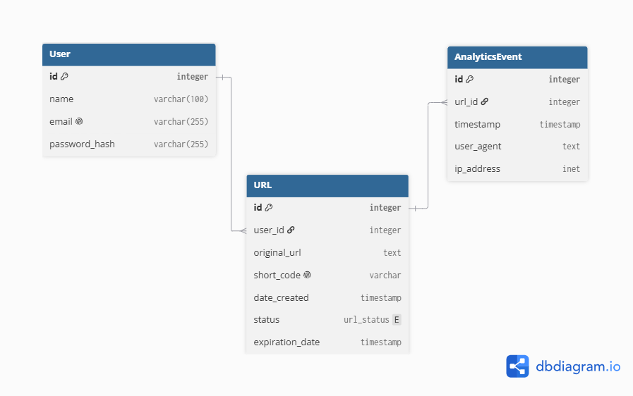

# Database Design

## 1. Entities

### 1. User

Represents a registered user who owns shortened URLs.

### 2. URL

Represents a shortened URL and its associated original URL and configuration.

### 3. Analytics Event

Represents a visit/click on a shortened URL and stores information needed for basic analytics.

## 2. Relationships

### User → URL

**Relationship:** One-to-Many (1:N)

**Description:**

One user can own multiple shortened URLs, but each shortened URL belongs to only one user.

For example:

User A  
└── URL 1  
└── URL 2  
└── URL 3

**Why:**

User accounts are included in the project requirements, and users need to be able to create and manage their own shortened URLs.

### URL → Analytics Event

**Relationship:** One-to-Many (1:N)

**Description:**

One shortened URL can have multiple analytics events because the same URL can be accessed multiple times. Each analytics event represents one visit or click on a shortened URL.

### Relationship Overview

```text
    User
     │
     │ 1:N
     ▼
    URL
     │
     │ 1:N
     ▼
Analytics Event
```

## 3. Table Design

### 3.1 User

The User table stores information about registered users.

| Column | Data Type | Required | Description |
|--------|-----------|----------|-------------|
| `id` | INTEGER GENERATED ALWAYS AS IDENTITY | Yes | Unique identifier for the user |
| `name` | VARCHAR(100) | Yes | User's name |
| `email` | VARCHAR(255) | Yes | User's email address |
| `password_hash` | VARCHAR(255) | Yes | Hashed password used for authentication |

### 3.2 URL

The URL table stores information about each shortened URL.

| Column | Data Type | Required | Description |
|--------|-----------|----------|-------------|
| `id` | INTEGER GENERATED ALWAYS AS IDENTITY | Yes | Unique identifier for the URL |
| `user_id` | INTEGER | Yes | Identifies the user who owns the URL |
| `original_url` | TEXT | Yes | The original long URL |
| `short_code` | VARCHAR(100) | Yes | Unique code used in the shortened URL |
| `date_created` | TIMESTAMP | Yes | Date and time when the shortened URL was created |
| `status` | ENUM | Yes | Indicates whether the shortened URL is active |
| `expiration_date` | TIMESTAMP | No | Date and time when the URL expires |

### 3.3 Analytics Event

The Analytics Event table stores information about each visit to a shortened URL.

| Column | Data Type | Required | Description |
|--------|-----------|----------|-------------|
| `id` | INTEGER GENERATED ALWAYS AS IDENTITY | Yes | Unique identifier for the analytics event |
| `url_id` | INTEGER | Yes | Identifies the shortened URL that was accessed |
| `time_stamp` | TIMESTAMP | Yes | Date and time when the URL was accessed |
| `user_agent` | TEXT | Yes | Information about the browser/device making the request |
| `ip_address` | INET | Yes | IP address associated with the request |

## 4. Constraints

### 4.1 Primary Keys

Each table has a primary key that uniquely identifies every record.

- `User.id` → Primary Key
- `URL.id` → Primary Key
- `AnalyticsEvent.id` → Primary Key

### 4.2 Foreign Keys

- `URL.user_id` references `User.id`
- `AnalyticsEvent.url_id` references `URL.id`

### 4.3 Delete Behavior

Foreign key relationships use cascading deletes:

- `URL.user_id` → `User.id` with `ON DELETE CASCADE`
- `AnalyticsEvent.url_id` → `URL.id` with `ON DELETE CASCADE`

When a user account is deleted, their URLs are deleted. The analytics events associated with those URLs are also deleted.

### 4.4 NOT NULL Constraints

The following columns are required and must not contain `NULL` values.

**User**
- `id`
- `name`
- `email`
- `password_hash`

**URL**
- `id`
- `user_id`
- `original_url`
- `short_code`
- `date_created`
- `status`

`expiration_date` is optional because a shortened URL may not have an expiration date.

**Analytics Event**
- `id`
- `url_id`
- `time_stamp`
- `user_agent`
- `ip_address`

### 4.5 UNIQUE Constraints

The following columns must contain unique values:

- `User.email` → `UNIQUE`
- `URL.short_code` → `UNIQUE`

### 4.6 Status Constraint

The `URL.status` column uses an ENUM to restrict the possible values.

Allowed values:

- `ACTIVE` — The shortened URL can be accessed.
- `EXPIRED` — The URL has passed its expiration date.
- `DISABLED` — The URL has been manually disabled.

## 5. Indexes

Indexes are used on columns that are frequently searched or used to retrieve related records.

### 5.1 URL Indexes

- `URL.short_code` → Unique index automatically created by the `UNIQUE` constraint. Used for fast URL redirection.
- `URL.user_id` → Index used to efficiently retrieve all URLs belonging to a specific user.

### 5.2 User Indexes

- `User.email` → Unique index automatically created by the `UNIQUE` constraint. Used during login and account-related operations.

### 5.3 Columns Without Indexes

- `URL.original_url` → No index because it is not frequently searched.
- `URL.status` → No standalone index because the main URL lookup is performed using `short_code`.
- `User.password_hash` → No index because users are not searched by password hash.

## 6. ER Diagram

The ER diagram represents the database entities, their attributes, and the relationships between them.



## 7. DBML Schema

The following DBML schema was used to create the ER diagram in dbdiagram.io.

```dbml
Table User {
    id integer [pk]
    name varchar(100)
    email varchar(255) [unique]
    password_hash varchar(255)
}

Table URL {
    id integer [pk]
    user_id integer
    original_url text
    short_code varchar(100) [unique]
    date_created timestamp
    status url_status
    expiration_date timestamp
}

Table AnalyticsEvent {
    id integer [pk]
    url_id integer
    time_stamp timestamp
    user_agent text
    ip_address inet
}

Enum url_status {
    ACTIVE
    EXPIRED
    DISABLED
}

Ref: User.id < URL.user_id
Ref: URL.id < AnalyticsEvent.url_id
```

## 8. PostgreSQL Schema

### 8.1 User Table

The following SQL creates the `User` table based on the database design above.

Use the following structure to create the table:

```sql
CREATE TABLE "User" (
    id INTEGER GENERATED ALWAYS AS IDENTITY PRIMARY KEY,
    name VARCHAR(100) NOT NULL,
    email VARCHAR(255) UNIQUE NOT NULL,
    password_hash VARCHAR(255) NOT NULL
);
```

### 8.2 URL Table

The following SQL creates the `URL` table based on the database design above.

Use the following structure to create the table:

```sql
CREATE TYPE url_status AS ENUM (
    'ACTIVE',
    'EXPIRED',
    'DISABLED'
);

CREATE TABLE "URL" (
    id INTEGER GENERATED ALWAYS AS IDENTITY PRIMARY KEY,
    user_id INTEGER NOT NULL,
    original_url TEXT NOT NULL, 
    short_code VARCHAR(100) UNIQUE NOT NULL,
    date_created TIMESTAMP NOT NULL,
    status url_status NOT NULL,
    expiration_date TIMESTAMP,
    FOREIGN KEY (user_id) REFERENCES "User"(id) ON DELETE CASCADE
);
```

### 8.3 Analytics Event Table

The following SQL creates the `AnalyticsEvent` table based on the database design above.

Use the following structure to create the table:

```sql
CREATE TABLE "AnalyticsEvent" (
    id INTEGER GENERATED ALWAYS AS IDENTITY PRIMARY KEY,
    url_id INTEGER NOT NULL,
    time_stamp TIMESTAMP NOT NULL,
    user_agent TEXT NOT NULL, 
    ip_address INET NOT NULL,
    FOREIGN KEY (url_id) REFERENCES "URL"(id) ON DELETE CASCADE
);
```

### 8.4 Indexes

The following index is created to improve the performance of frequently used queries.

```sql
CREATE INDEX idx_url_user_id
ON "URL" (user_id);
```

## 9. Design Review

The database design was reviewed to ensure that it satisfies the project requirements and is consistent with the planned application architecture.

### Review Checklist

- [x] All required entities are included.
- [x] Relationships between entities are correctly defined.
- [x] Primary keys and foreign keys are defined.
- [x] Required fields use `NOT NULL`.
- [x] Unique constraints are applied where needed.
- [x] URL expiration is supported.
- [x] Basic analytics are supported through analytics events.
- [x] Appropriate indexes are defined.
- [x] Cascading delete behavior is defined.
- [x] The database uses PostgreSQL-compatible data types and constraints.
- [x] The ER diagram matches the database design.
- [x] The DBML schema matches the ER diagram.
- [x] The PostgreSQL schema matches the database design.