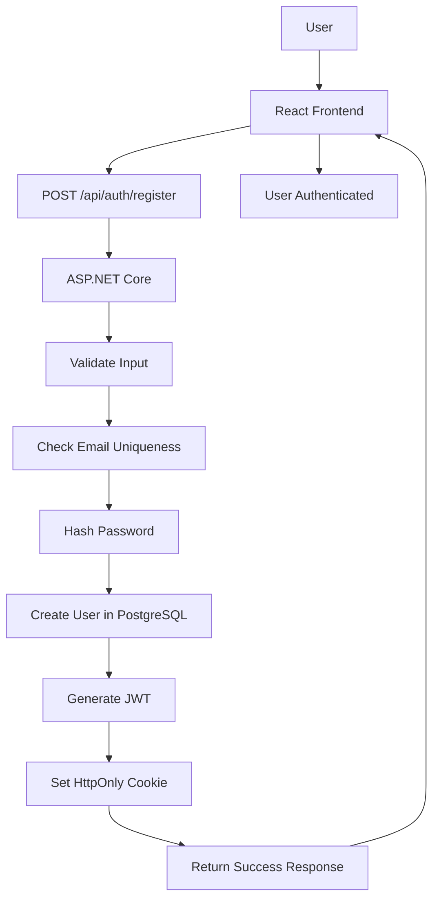
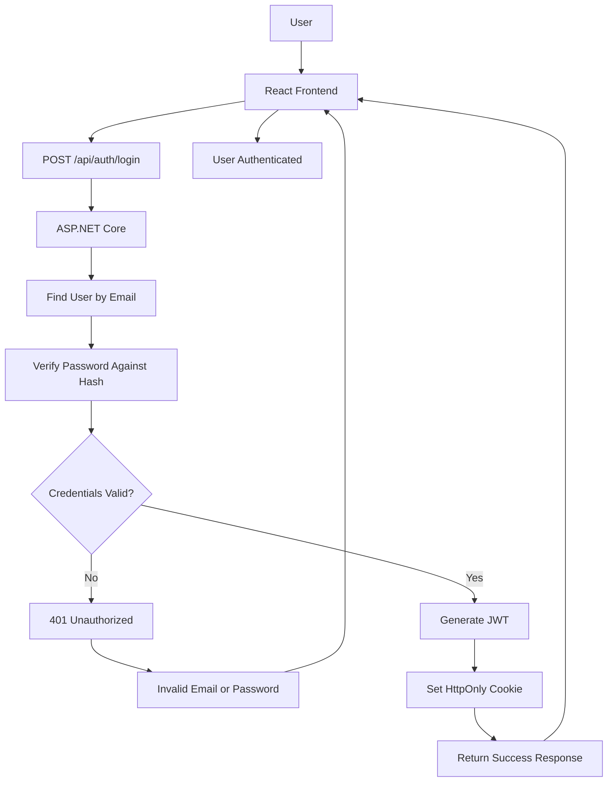
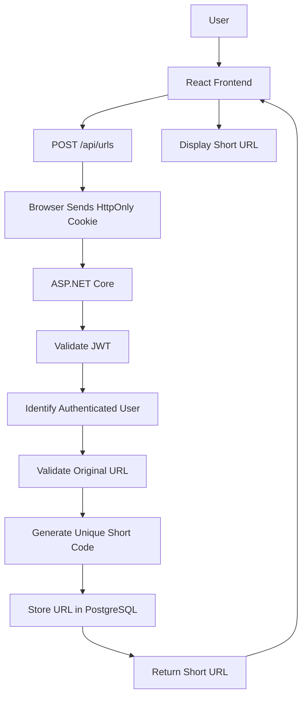
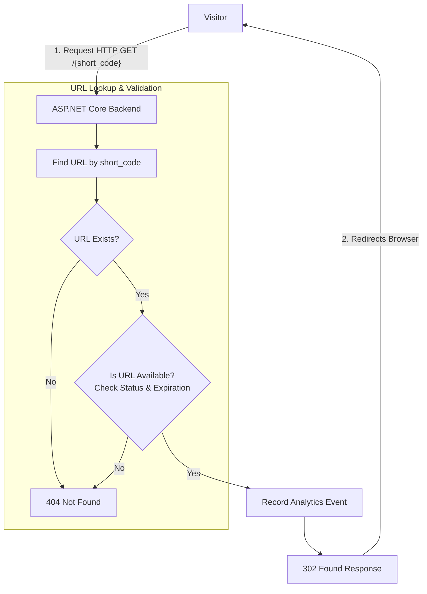
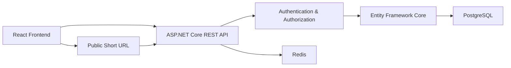

# API Design

## 1. API Overview

The API acts as the communication layer between the React frontend and the ASP.NET Core backend.

### API Responsibilities

* Receive requests from the frontend.
* Validate and process incoming data.
* Apply the application's business logic.
* Communicate with the PostgreSQL database.
* Return appropriate responses to the frontend.
* Handle authentication and authorization.

## 2. API Requirements

The API should provide the operations required for users to interact with the URL shortener application.

### User Management

* Register a new user account.
* Log in an existing user.
* Log out an authenticated user.

### URL Management

* Create a shortened URL.
* View the authenticated user's shortened URLs.
* Edit a shortened URL.
* Delete a shortened URL.
* Disable/Enable a shortened URL.

### URL Redirection

* Redirect a visitor from a short URL to its original URL.
* Check whether the URL is active, expired, or disabled before redirecting.
* Record a basic analytics event when a short URL is accessed.

### Analytics

* View basic analytics for a shortened URL.

## 3. Endpoint Design

The API endpoints are organized around the main resources and operations of the URL shortener application. Authentication-related operations are grouped under `/api/auth`, while URL-related operations are grouped under `/api/urls`.

### 3.1 Authentication Endpoints

| Operation       | HTTP Method | Endpoint             | Access    |
| --------------- | ----------- | -------------------- | --------- |
| Register a user | POST        | `/api/auth/register` | Public    |
| Log in a user   | POST        | `/api/auth/login`    | Public    |
| Log out a user  | POST        | `/api/auth/logout`   | Protected |

### 3.2 URL Management Endpoints

| Operation                      | HTTP Method | Endpoint                | Access    |
| ------------------------------ | ----------- | ----------------------- | --------- |
| Create a shortened URL         | POST        | `/api/urls`             | Protected |
| View user's shortened URLs     | GET         | `/api/urls`             | Protected |
| Edit a shortened URL           | PUT         | `/api/urls/{id}`        | Protected |
| Delete a shortened URL         | DELETE      | `/api/urls/{id}`        | Protected |
| Enable/Disable a shortened URL | PUT         | `/api/urls/{id}/status` | Protected |

The `{id}` parameter identifies a specific URL resource in the database.

### 3.3 URL Redirection Endpoint

| Operation                    | HTTP Method | Endpoint        | Access |
| ---------------------------- | ----------- | --------------- | ------ |
| Redirect to the original URL | GET         | `/{short_code}` | Public |

The `{short_code}` parameter identifies the shortened URL that the visitor wants to access.

When this endpoint is called, the backend will find the corresponding URL, check its status and expiration, record an analytics event, and redirect the visitor to the original URL.

### 3.4 Analytics Endpoint

| Operation          | HTTP Method | Endpoint                   | Access    |
| ------------------ | ----------- | -------------------------- | --------- |
| View URL analytics | GET         | `/api/urls/{id}/analytics` | Protected |

The `{id}` parameter identifies the URL whose analytics the authenticated user wants to view.

### 3.5 Endpoint Summary

The planned API endpoints are:

```text
POST   /api/auth/register
POST   /api/auth/login
POST   /api/auth/logout

POST   /api/urls
GET    /api/urls
PUT    /api/urls/{id}
DELETE /api/urls/{id}
PUT    /api/urls/{id}/status

GET    /{short_code}

GET    /api/urls/{id}/analytics
```

Public endpoints can be accessed without authentication, while protected endpoints require the user to be authenticated and authorized to perform the requested operation.

## 4. Request & Response Design

The API will use JSON for most request and response bodies. Authentication for protected endpoints will be handled using an HttpOnly cookie containing the JWT. The browser will automatically send this cookie with requests to the backend.

### 4.1 Register a User

**Endpoint:**

```text
POST /api/auth/register
```

**Request Body:**

```json
{
  "name": "Mayar",
  "email": "mayar@example.com",
  "password": "mypassword"
}
```

The backend will validate the information, check whether the email is already registered, hash the password, and store the new user in the database.

**Successful Response:**

```json
{
  "message": "User registered successfully"
}
```

The password or password hash will not be included in the response.

After successful registration, the backend will also generate a JWT and store it in an HttpOnly cookie.

### 4.2 Log In a User

**Endpoint:**

```text
POST /api/auth/login
```

**Request Body:**

```json
{
  "email": "mayar@example.com",
  "password": "mypassword"
}
```

The backend will find the user by email and verify the provided password against the stored password hash. If the credentials are valid, the API will generate a JWT and store it in an HttpOnly cookie.

**Successful Response:**

```json
{
  "message": "Login successful"
}
```

The JWT will not be returned in the JSON response because it will be stored in the HttpOnly cookie.

### 4.3 Log Out a User

**Endpoint:**

```text
POST /api/auth/logout
```

The browser will automatically send the authentication cookie with the request.

The backend will clear the authentication cookie.

**Successful Response:**

```json
{
  "message": "Logout successful"
}
```

After receiving a successful response, the frontend will update the user's authentication state and navigate the user appropriately.

### 4.4 Create a Shortened URL

**Endpoint:**

```text
POST /api/urls
```

The browser will automatically send the HttpOnly authentication cookie with the request.

**Request Body:**

```json
{
  "originalUrl": "https://example.com/some/very/long/url",
  "expirationDate": "2026-12-31T23:59:59"
}
```

The `expirationDate` is optional. If the user does not want the URL to expire, it can be set to `null`.

The backend will validate the original URL, identify the authenticated user from the JWT, generate a unique short code, set the creation date, set the initial status to `ACTIVE`, and store the URL in PostgreSQL.

The database-generated `id` and backend-generated values such as `shortCode`, `dateCreated`, and `status` do not need to be provided by the frontend.

**Successful Response:**

```json
{
  "originalUrl": "https://example.com/some/very/long/url",
  "shortCode": "abc123",
  "shortUrl": "https://ourdomain.com/abc123",
  "expirationDate": "2026-12-31T23:59:59"
}
```

The response provides the frontend with the shortened URL and the information needed to display it to the user.

### 4.5 View User's Shortened URLs

**Endpoint:**

```text
GET /api/urls
```

The browser will automatically send the HttpOnly authentication cookie with the request.

The frontend does not need to provide a `user_id`. The backend will identify the authenticated user from the JWT and retrieve only the URLs belonging to that user.

**Successful Response:**

```json
[
  {
    "shortCode": "abc123",
    "shortUrl": "https://ourdomain.com/abc123",
    "originalUrl": "https://example.com/page",
    "dateCreated": "2026-10-08T10:30:00",
    "status": "ACTIVE",
    "expirationDate": "2026-12-31T23:59:59"
  },
  {
    "shortCode": "xyz789",
    "shortUrl": "https://ourdomain.com/xyz789",
    "originalUrl": "https://example.com/another-page",
    "dateCreated": "2026-10-07T14:20:00",
    "status": "DISABLED",
    "expirationDate": null
  }
]
```

The response contains the information needed by the frontend to display the user's shortened URLs.

For the MVP, the API can return the user's URLs in a single response. Pagination can be introduced later if the number of URLs becomes large.

### 4.6 Edit a Shortened URL

**Endpoint:**

```text
PUT /api/urls/{id}
```

The browser will automatically send the HttpOnly authentication cookie with the request.

The `{id}` parameter identifies the specific URL that the authenticated user wants to edit.

**Request Body:**

```json
{
  "originalUrl": "https://example.com/new-page",
  "expirationDate": "2027-01-31T23:59:59"
}
```

The user can modify the original URL and expiration date.

The following properties cannot be modified through this endpoint:

* `id`
* `userId`
* `shortCode`
* `dateCreated`
* `status`

The `shortCode` cannot be changed because custom aliases are excluded from the project scope. The `status` is controlled by the backend and can change when a URL is disabled or expires.

**Successful Response:**

```json
{
  "message": "URL updated successfully",
  "shortCode": "abc123",
  "shortUrl": "https://ourdomain.com/abc123",
  "originalUrl": "https://example.com/new-page",
  "expirationDate": "2027-01-31T23:59:59"
}
```

The backend will verify that the URL belongs to the authenticated user before allowing it to be modified.

### 4.7 Delete a Shortened URL

**Endpoint:**

```text
DELETE /api/urls/{id}
```

The browser will automatically send the HttpOnly authentication cookie with the request.

The `{id}` parameter identifies the specific URL that the authenticated user wants to delete.

No request body is required because the URL ID is provided directly in the endpoint.

**Example Request:**

```text
DELETE /api/urls/42
```

The backend will verify that the URL exists and belongs to the authenticated user before deleting it.

When the URL is deleted, its associated analytics events will also be deleted because the database relationship uses `ON DELETE CASCADE`.

**Successful Response:**

```text
204 No Content
```

No response body will be returned.

### 4.8 Update URL Status

**Endpoint:**

```text
PUT /api/urls/{id}/status
```

The browser will automatically send the HttpOnly authentication cookie with the request.

The `{id}` parameter identifies the specific URL whose status the authenticated user wants to change.

**Request Body:**

```json
{
  "status": "DISABLED"
}
```

The user can change the URL status between `ACTIVE` and `DISABLED`.

For example, a user can disable an active URL:

```json
{
  "status": "DISABLED"
}
```

or reactivate a disabled URL:

```json
{
  "status": "ACTIVE"
}
```

The `EXPIRED` status cannot be set manually by the user. It is controlled by the backend based on the URL's expiration date.

The backend will verify that the URL belongs to the authenticated user and that the requested status is valid before updating it.

**Successful Response:**

```json
{
  "message": "URL status updated successfully",
  "status": "DISABLED"
}
```

The same endpoint can be used to reactivate a disabled URL by sending `ACTIVE` as the new status.

### 4.9 URL Redirection

**Endpoint:**

```text
GET /{short_code}
```

The `{short_code}` parameter identifies the shortened URL that the visitor wants to access.

**Access:**

Public. The visitor does not need to be authenticated to use a shortened URL.

**Request:**

No request body is required.

**Example Request:**

```text
GET /abc123
```

When the endpoint is called, the backend will:

1. Look up the URL using the `short_code`.
2. Check whether the URL exists.
3. Check whether the URL is active and has not expired.
4. Record a basic analytics event.
5. Return an HTTP redirect response to the original URL.

**Successful Response:**

The API will return an HTTP redirect response rather than a JSON response.

```text
HTTP 302 Found

Location: https://example.com/some/long/url
```

The browser will then follow the `Location` header and navigate to the original URL.

If the shortened URL does not exist, is disabled, or has expired, the API will return an appropriate error response instead of redirecting the visitor.

### 4.10 View URL Analytics

**Endpoint:**

```text
GET /api/urls/{id}/analytics
```

The browser will automatically send the HttpOnly authentication cookie with the request.

No request body is required.

The backend verifies that the URL belongs to the authenticated user and retrieves its analytics information.

The analytics response provides a basic summary of the URL's usage and its click history.

**Successful Response:**

```json
{
  "shortCode": "abc123",
  "totalClicks": 125,
  "lastAccessed": "2026-10-08T12:45:00",
  "expirationDate": "2026-12-31T23:59:59",
  "status": "ACTIVE",
  "clickHistory": [
    {
      "timeStamp": "2026-10-08T12:45:00"
    },
    {
      "timeStamp": "2026-10-08T11:30:00"
    },
    {
      "timeStamp": "2026-10-07T18:20:00"
    }
  ]
}
```

The `totalClicks` value represents the total number of times the shortened URL has been accessed.

The `lastAccessed` value shows the timestamp of the most recent access.

The `expirationDate` is returned when the URL has an expiration date. If the URL does not expire, this value is `null`.

The frontend can calculate and display the remaining time until expiration using the `expirationDate`.

The `clickHistory` contains the timestamps of individual accesses. The frontend can display this information in an expandable table so that the user can view the detailed click history when needed.

The `user_agent` and `ip_address` stored in the `AnalyticsEvent` table will not be exposed in the basic analytics response. They can be used later for advanced analytics such as browser, device, and geographic statistics.

## 5. HTTP Status Codes

The API will use standard HTTP status codes to communicate the result of each request to the frontend. This allows the frontend to determine whether a request was successful or whether an error occurred.

### 5.1 Success Status Codes

| Status Code | Name       | Usage                                                                |
| ----------- | ---------- | -------------------------------------------------------------------- |
| 200         | OK         | The request was successful and a response is returned.               |
| 201         | Created    | A new resource was successfully created.                             |
| 204         | No Content | The request was successful, but there is no response body to return. |
| 302         | Found      | The requested short URL redirects the visitor to the original URL.   |

Examples:

| Endpoint                    | Status Code | Reason                                                             |
| --------------------------- | ----------: | ------------------------------------------------------------------ |
| `POST /api/auth/register`   |         201 | A new user was created.                                            |
| `POST /api/auth/login`      |         200 | Login was successful and the authentication cookie was set.        |
| `POST /api/urls`            |         201 | A new shortened URL was created.                                   |
| `GET /api/urls`             |         200 | The user's URLs were successfully retrieved.                       |
| `PUT /api/urls/{id}`        |         200 | The URL was successfully updated and its data is returned.         |
| `PUT /api/urls/{id}/status` |         200 | The URL status was successfully updated.                           |
| `DELETE /api/urls/{id}`     |         204 | The URL was successfully deleted and no response body is required. |
| `GET /{short_code}`         |         302 | The visitor is redirected to the original URL.                     |

### 5.2 Client Error Status Codes

Client error status codes indicate that the request could not be completed because of a problem with the request or the user's access.

| Status Code | Name         | Usage                                                                                    |
| ----------- | ------------ | ---------------------------------------------------------------------------------------- |
| 400         | Bad Request  | The request is invalid or contains invalid data.                                         |
| 401         | Unauthorized | The user is not authenticated or the authentication cookie is missing or invalid.        |
| 403         | Forbidden    | The user is authenticated but does not have permission to access the requested resource. |
| 404         | Not Found    | The requested resource does not exist or is not available.                               |
| 409         | Conflict     | The request conflicts with existing data.                                                |

Examples:

| Situation                                                 | Status Code | Reason                                          |
| --------------------------------------------------------- | ----------: | ----------------------------------------------- |
| User registers with an existing email                     |         409 | The email already belongs to another account.   |
| User provides an invalid URL                              |         400 | The request contains invalid data.              |
| User accesses a protected endpoint without authentication |         401 | Authentication is required.                     |
| User tries to modify another user's URL                   |         403 | The user does not have permission to modify it. |
| Requested URL ID does not exist                           |         404 | The requested resource cannot be found.         |
| Short code does not exist                                 |         404 | The shortened URL cannot be found.              |
| Short URL has expired                                     |         404 | The shortened URL is no longer available.       |
| Short URL has been disabled                               |         404 | The shortened URL is no longer available.       |

For expired or disabled short URLs, the API will return `404 Not Found` rather than exposing the specific reason why the URL is unavailable.

### 5.3 Server Error Status Codes

| Status Code | Name                  | Usage                                                                               |
| ----------- | --------------------- | ----------------------------------------------------------------------------------- |
| 500         | Internal Server Error | An unexpected error occurred on the backend and the request could not be completed. |

Examples of situations that could result in a server error include:

* An unexpected exception occurs in the backend.
* A database operation fails unexpectedly.
* An unexpected infrastructure or server-side problem occurs.

The API should not expose sensitive internal information such as stack traces, database errors, or implementation details to the client. Detailed error information should instead be recorded in the server logs for debugging and monitoring.

### 5.4 Status Code Summary

```text
2xx — Success
    200 OK
    201 Created
    204 No Content

3xx — Redirection
    302 Found

4xx — Client Errors
    400 Bad Request
    401 Unauthorized
    403 Forbidden
    404 Not Found
    409 Conflict

5xx — Server Errors
    500 Internal Server Error
```

## 6. Authentication & Authorization

Authentication and authorization will be used to protect user accounts and ensure that users can only access and manage their own shortened URLs.

### 6.1 Authentication

Authentication is the process of verifying the identity of a user. In this project, authentication will be implemented using JSON Web Tokens (JWT).

#### Registration

The registration endpoint is public and allows a new user to create an account.

```text
User
  ↓
POST /api/auth/register
  ↓
Validate input
  ↓
Check email uniqueness
  ↓
Hash password
  ↓
Store user in PostgreSQL
  ↓
Generate JWT
  ↓
Set HttpOnly cookie
  ↓
User is authenticated
```

When a user registers, the backend will:

1. Validate the submitted name, email, and password.
2. Check whether the email is already registered.
3. Hash the password before storing it.
4. Create the user in PostgreSQL.
5. Generate a JWT for the newly registered user.
6. Store the JWT in a secure HttpOnly cookie.
7. Return a successful registration response.

The user's password will never be stored directly in the database.

#### Login

The login endpoint is public.

```text
User
  ↓
POST /api/auth/login
  ↓
Find user by email
  ↓
Verify password against hash
  ↓
Correct?
  ├── No → 401 Unauthorized
  │         "Invalid email or password"
  │
  └── Yes
       ↓
   Generate JWT
       ↓
   Set HttpOnly cookie
       ↓
   User is authenticated
```

When a user logs in, the backend will:

1. Find the user using the submitted email.
2. Verify the submitted password against the stored password hash.
3. If the credentials are invalid, return `401 Unauthorized` with a generic `Invalid email or password` message.
4. If the credentials are valid, generate a JWT.
5. Store the JWT in a secure HttpOnly cookie.
6. Return a successful login response.

The API will use the same generic error message for an invalid email or password so that it does not reveal whether a particular email address is registered.

#### JWT

A JSON Web Token (JWT) will be used to represent the authenticated user.

The token will contain information needed by the backend to identify the user, such as the user's ID, along with an expiration time.

Conceptually, the token contains:

```text
JWT
├── User ID
├── Issued At
└── Expiration
```

The JWT will expire after **30 minutes**.

The JWT will not contain the user's password or password hash.

#### JWT Storage

The JWT will be stored in an **HttpOnly cookie**.

An HttpOnly cookie cannot be directly accessed by JavaScript running in the browser. The browser automatically sends the cookie with requests to the backend.

The detailed implementation and security concepts related to cookies will be learned during Phase 2, including:

* HttpOnly
* Secure
* SameSite
* CSRF protection
* Cookie configuration in ASP.NET Core
* Sending authenticated requests from React

#### Authenticated Requests

After authentication, the frontend does not need to send the user's email or password with every request.

For example:

```text
React
  ↓
GET /api/urls
  ↓
Browser automatically includes authentication cookie
  ↓
ASP.NET Core validates JWT
  ↓
Identify user
  ↓
Return user's URLs
```

The backend will validate the JWT before allowing access to protected endpoints.

The user ID will be obtained from the validated JWT rather than being provided by the frontend.

#### Token Expiration

The JWT access token will expire after 30 minutes.

When the token is valid:

```text
JWT valid
   ↓
Protected request
   ↓
Request allowed
```

When the token has expired:

```text
JWT expired
   ↓
Protected request
   ↓
401 Unauthorized
   ↓
Frontend requires the user to log in again
```

Refresh tokens will not be included in the MVP. They can be considered later if the authentication system is extended.

#### Logout

The project will provide:

```text
POST /api/auth/logout
```

Logout will remove the authentication cookie so that the browser no longer sends it with subsequent requests.

The MVP will not implement refresh tokens or server-side token revocation. Therefore, the authentication design will rely on the 30-minute JWT expiration in addition to removing the authentication cookie during logout.

### 6.2 Authorization

Authorization determines whether an authenticated user is allowed to perform a particular operation.

The backend will use the authenticated user's ID from the validated JWT to enforce access control.

#### URL Ownership

Each URL belongs to the user who created it through the `user_id` foreign key defined in the database design.

For example:

```text
User A

User ID = 42
      ↓
JWT
      ↓
User ID = 42
      ↓
PUT /api/urls/15
      ↓
Backend finds URL 15
      ↓
URL owner = User 42
      ↓
Ownership confirmed
      ↓
Allow operation
```

If the URL belongs to another user:

```text
User A

User ID = 42
      ↓
JWT
      ↓
User ID = 42
      ↓
PUT /api/urls/27
      ↓
Backend finds URL 27
      ↓
URL owner = User 99
      ↓
42 ≠ 99
      ↓
403 Forbidden
```

The backend must perform these ownership checks. The frontend must not be trusted to provide or determine the user's ID.

For example, the frontend should not send:

```json
{
  "userId": 42
}
```

to determine which user owns a URL.

Instead, the backend obtains the user ID from the validated JWT.

#### Viewing User URLs

For:

```text
GET /api/urls
```

the frontend does not provide a `user_id`.

The backend obtains the authenticated user's ID from the JWT and retrieves only URLs belonging to that user.

Conceptually:

```text
JWT → User ID 42

          ↓

Retrieve URLs

WHERE user_id = 42
```

#### Ownership-Protected Operations

The backend will verify URL ownership for:

* `GET /api/urls`
* `PUT /api/urls/{id}`
* `DELETE /api/urls/{id}`
* `PUT /api/urls/{id}/status`
* `GET /api/urls/{id}/analytics`

If an authenticated user attempts to access or modify a URL owned by another user, the API will return:

```text
403 Forbidden
```

#### Public URL Redirection

The short URL redirection endpoint is public because visitors should not need an account to access a shortened URL.

```text
Visitor
  ↓
GET /{short_code}
  ↓
Find URL
  ↓
Check status and expiration
  ↓
Record analytics
  ↓
302 Redirect
```

No user ownership check is required for the redirect because an active short URL is intended to be publicly accessible.

### 6.3 Authentication and Authorization Rules

| Operation          | Authentication | Authorization      |
| ------------------ | -------------- | ------------------ |
| Register           | Not required   | Public             |
| Login              | Not required   | Public             |
| Logout             | Required       | Authenticated user |
| Create URL         | Required       | Authenticated user |
| View own URLs      | Required       | Own URLs only      |
| Edit URL           | Required       | URL owner only     |
| Delete URL         | Required       | URL owner only     |
| Change URL status  | Required       | URL owner only     |
| Redirect short URL | Not required   | Public             |
| View analytics     | Required       | URL owner only     |

### Authentication and Authorization Flow

The overall authentication and authorization process is:

```text
Registration / Login
        ↓
Verify user credentials
        ↓
Generate JWT
        ↓
Store JWT in HttpOnly cookie
        ↓
User becomes authenticated
        ↓
Frontend sends API request
        ↓
Browser automatically sends cookie
        ↓
ASP.NET Core validates JWT
        ↓
Identify authenticated user
        ↓
Check authorization / resource ownership
        ↓
Allow or reject request
```

This design separates authentication from authorization:

```text
Authentication

"What user is making this request?"

        ↓

JWT

        ↓

User ID


Authorization

"Is this user allowed to perform this operation?"

        ↓

Ownership / access check

        ↓

Allow or reject
```

## 7. Error Response Design

The API will use a consistent JSON format for error responses. HTTP status codes will indicate the type of error, while the response message will provide a clear description of what went wrong.

### 7.1 General Error Format

API errors will return a JSON response containing a `message` field.

```json
{
  "message": "Invalid URL"
}
```

Examples:

| Status Code | Example Message                             |
| ----------- | ------------------------------------------- |
| 400         | `Invalid URL`                               |
| 401         | `Invalid email or password`                 |
| 403         | `You are not authorized to modify this URL` |
| 404         | `URL not found`                             |
| 409         | `Email already exists`                      |
| 500         | `An unexpected error occurred`              |

The HTTP status code communicates the type of error, while the message explains the specific problem.

### 7.2 Validation Errors

When multiple fields in a request are invalid, the API may return additional field-specific error information.

Example:

```json
{
  "message": "Invalid request",
  "errors": {
    "email": "Email is required",
    "password": "Password must be at least 8 characters"
  }
}
```

This allows the React frontend to display the appropriate validation message for each field.

### 7.3 Security Considerations

The API should not expose sensitive internal information to the frontend.

For example, database errors, stack traces, or internal implementation details should not be returned directly to the client.

Instead of returning a technical database error such as:

```text
PostgreSQL exception: duplicate key violates constraint...
```

the API should return a safe message:

```json
{
  "message": "An unexpected error occurred"
}
```

Detailed technical errors can be recorded in backend logs for debugging and monitoring.

### 7.4 Error Response Summary

The API will follow these general rules:

* Use standard HTTP status codes to indicate the type of error.
* Return a consistent JSON response containing a `message` field.
* Include field-specific `errors` when detailed validation feedback is useful.
* Do not expose passwords, database errors, stack traces, or other sensitive internal information.
* Record detailed technical errors in backend logs instead of returning them to the client.

## 8. API Flow Diagrams

The following diagrams illustrate the main API flows of the URL shortener. They show how the React frontend communicates with the ASP.NET Core backend and how authentication, database operations, and URL redirection work together.

### 8.1 User Registration Flow

The registration flow creates a new user account and automatically authenticates the user after successful registration.



### 8.2 User Login Flow

The login flow verifies the user's credentials and creates a JWT when the credentials are valid.



### 8.3 Create Short URL Flow

The create URL flow demonstrates how authentication is used to identify the user before creating and storing a shortened URL.



### 8.4 Short URL Redirection Flow

The redirection flow is public and does not require authentication. The backend finds the shortened URL, checks whether it is available, records an analytics event, and redirects the visitor.



### 8.5 Overall API Architecture Flow

The main API flows can be summarized as:



Redis is included in the overall architecture because it will be used later for caching and scalability. The initial MVP implementation can operate without Redis, while the caching layer will be introduced during the scalability phase.

## 9. Final Design Summary

The API will use **React** as the frontend client and **ASP.NET Core** as the backend REST API. **Entity Framework Core** will handle database access to **PostgreSQL**, while **Redis** will be introduced later for caching and scalability.

The API will use **JWT-based authentication** with JWTs stored in **HttpOnly cookies**. Protected endpoints will use the authenticated user's identity to enforce authorization and URL ownership.

The API design follows the requirements and database design defined in the previous project phases while leaving room for future features such as advanced analytics, caching, rate limiting, pagination, and scalability improvements.

This API design provides the foundation needed to begin implementing the backend during the next phases of the project.
