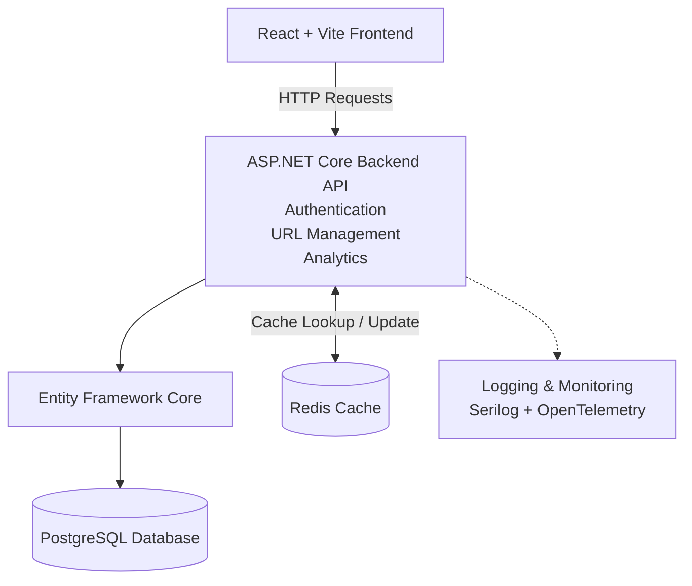
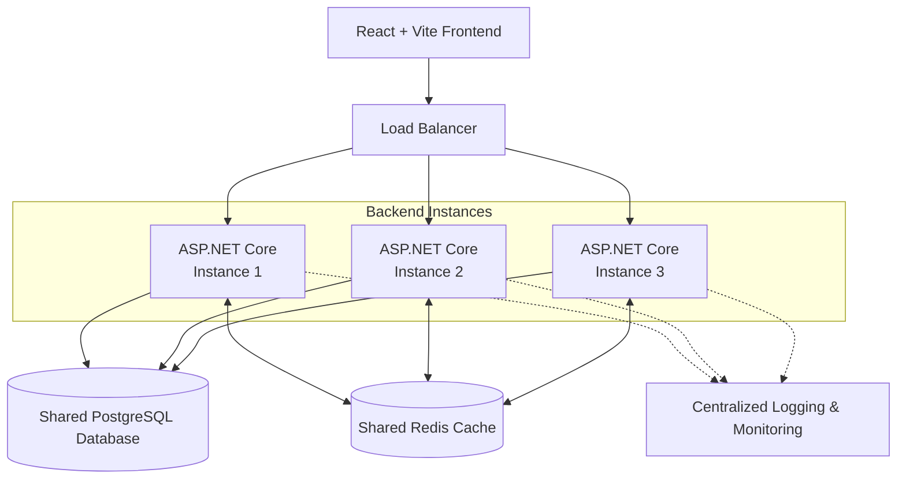
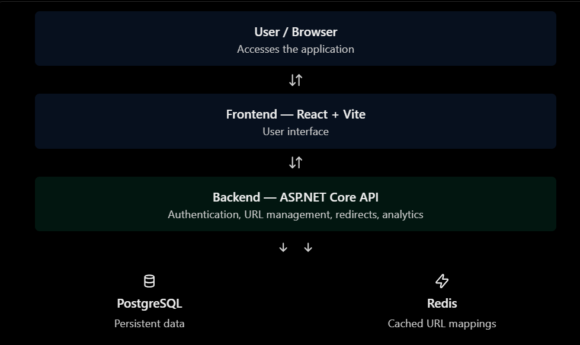
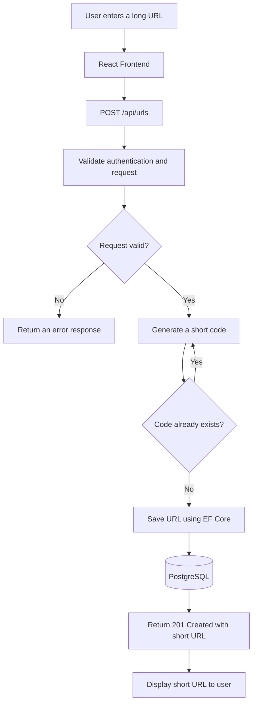
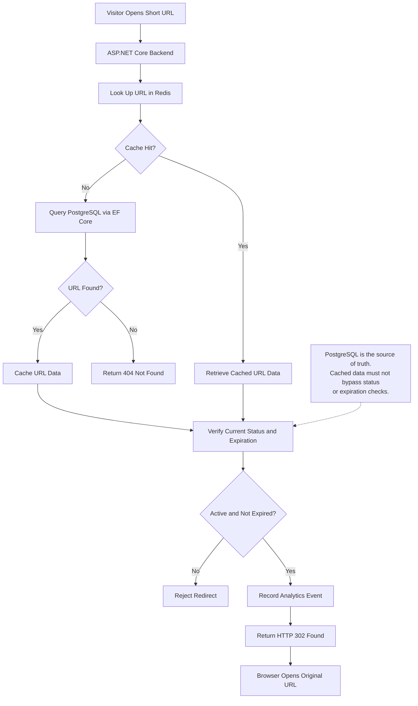
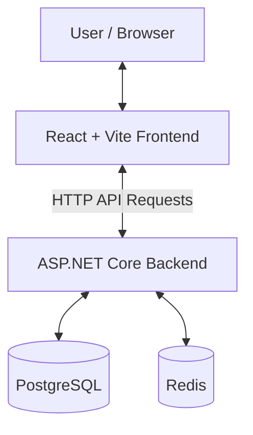
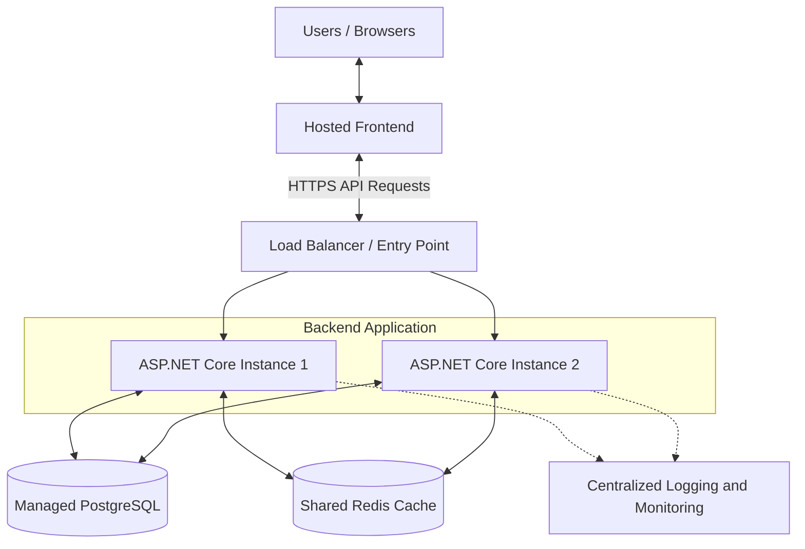

## 1. Architecture Overview

### Architecture Style

The architecture style chosen for this project is a **Modular Monolith**. The backend will be developed as one application, but its code will be organized into separate modules based on their responsibilities.

### Why This Architecture?

A modular monolith is suitable for this project because it is simpler to develop and deploy than a microservices architecture. Separating responsibilities into modules makes the code easier to understand, test, and maintain as the project grows.

### Future Scalability

Although the application starts as a single backend, its design can support future scalability improvements. These may include running multiple backend instances behind a load balancer, using Redis for caching, and optimizing database queries and indexes. This approach allows the project to evolve without introducing the additional complexity of microservices from the beginning.

## 2. System Components

### 2.1 Frontend — React + Vite

**React** will be used to build the user interface, allowing users to register, log in, log out, create short URLs, view and manage their links, and view basic analytics.

**Vite** will provide the frontend development server and build tooling, making development easier and preparing the frontend files for deployment.

The frontend will communicate with the ASP.NET Core backend through HTTP API requests. It will not connect directly to PostgreSQL or Redis; database access and backend operations will be handled by the server.

### 2.2 Backend — C# + ASP.NET Core

The backend will be written in C# using the ASP.NET Core framework. It will expose API endpoints that allow the frontend to communicate with the application and perform the required operations.

The backend will contain the application's business logic, including URL validation, short-code generation, URL redirection, expiration and status checks, authentication, authorization, and analytics collection.

It will also handle communication with the database through Entity Framework Core and PostgreSQL. Redis may be integrated later to cache frequently accessed data and improve redirect performance.

### 2.3 Database Access — Entity Framework Core

Entity Framework Core (EF Core) will be used as the Object-Relational Mapper (ORM) for communicating with PostgreSQL. It allows the backend to work with database records through C# objects and LINQ queries instead of manually writing SQL for every operation.

The PostgreSQL provider, Npgsql, will allow EF Core to communicate with the PostgreSQL database. EF Core will also support database migrations, relationships, and transactions.

Although EF Core reduces repetitive database code, understanding SQL remains important for writing efficient queries, creating indexes, and investigating performance issues.

### 2.4 Database — PostgreSQL

PostgreSQL will be the primary relational database for the application. It will persist the application's data, including user accounts, shortened URLs, and analytics events.

Each shortened URL will have a unique short code associated with its original URL. When a visitor accesses a short link, the backend will look up the short code in PostgreSQL to retrieve the original URL and perform the redirect.

PostgreSQL will also store user information, including email addresses and password hashes, as well as analytics data such as access timestamps, user agents, and IP addresses. This information will support authentication, URL management, and basic analytics.

PostgreSQL will remain the source of truth for persistent application data, even if caching is introduced later.

### 2.5 Caching — Redis

Redis will be introduced as an in-memory caching layer to improve the performance of frequently accessed short URLs.

The backend will use Redis to cache mappings between short codes and original URLs. When a redirect request arrives, the backend will first check Redis. If the mapping is cached, it can retrieve the original URL without querying PostgreSQL. If the mapping is not cached, the backend will retrieve it from PostgreSQL and may store it in Redis for subsequent requests.

PostgreSQL will remain the source of truth, while Redis will hold temporary cached data. This caching approach can reduce repeated database queries and improve redirect response times. Redis will be added after the core functionality is implemented and tested.

### 2.6 Testing and API Tools — xUnit + Postman

**xUnit** will be used for automated testing of the backend. It will help verify that individual components and business logic behave as expected, including URL validation, short-code generation, and expiration checks. Integration tests can also be used to verify interactions between backend components and the database.

**Postman** will be used for manual API testing during development. It will allow HTTP requests to be sent to the API endpoints and their responses to be inspected, including status codes, response bodies, and headers. It will help verify that the API behaves according to the API design.

### 2.7 API Documentation — OpenAPI + Swagger UI

OpenAPI will be used to describe the application's API endpoints, including their request parameters, request bodies, and expected responses.

Swagger UI will provide an interactive interface for viewing the API documentation and sending test requests during development. This will make it easier to understand and test the API endpoints.

API documentation will also help frontend development by providing a clear reference for how the frontend should communicate with the ASP.NET Core backend.

### 2.8 Containerization — Docker + Docker Compose

Docker will be used to package application components and their required dependencies into containers, helping ensure they run consistently across different environments.

Docker Compose will be used to define and run multiple containers together, such as the frontend, backend, PostgreSQL database, and Redis cache. It will simplify local development by allowing these services to be started and managed together.

Containerization will also make the application easier to deploy and maintain across development and production environments.

### 2.9 Logging and Monitoring — Serilog + OpenTelemetry

Serilog will be used to record application logs, including errors, warnings, and important events. These logs will help with debugging problems and understanding the application's behavior.

OpenTelemetry will be used to collect telemetry data, such as traces and metrics, to help monitor application performance and investigate issues across different components.

Together, these tools will help identify problems such as slow API responses, database query delays, and failures during URL redirection. They will support troubleshooting and performance monitoring as the application grows.

### 2.10 Deployment — Microsoft Azure

Microsoft Azure will be considered as the cloud platform for deploying the application and making it accessible to users over the internet.

The frontend, backend, and supporting services will need to be hosted in an appropriate environment. Azure services will be selected based on the application's requirements, cost, and scalability needs.

The deployment approach may evolve as the project grows, allowing the application to support multiple backend instances, managed database services, and other infrastructure improvements when needed.

## 3. High-Level Architecture Diagram

### 3.1 Initial Architecture — MVP

The initial architecture represents the main components required to run the URL shortener during development and the MVP stage.

The frontend sends HTTP requests to the ASP.NET Core backend. The backend handles authentication, URL management, and analytics. Entity Framework Core (EF Core) manages database access to PostgreSQL, while Redis can be used to cache frequently accessed URL information. Logging and monitoring tools help track application behavior and investigate errors.

### 3.2 Future Scalable Architecture

The future architecture illustrates how the application could handle increased traffic by running multiple backend instances behind a load balancer.

All backend instances use the same PostgreSQL database and shared Redis cache. The load balancer distributes incoming requests across the instances. Centralized logging and monitoring help observe the application across the different instances.

This architecture is a future scalability plan, not a requirement for the initial MVP. The detailed implementation of cloud hosting and load balancing will be considered in a later phase.

### Basic Architecture

## 4. Main Request Flows

### 4.1 Create a Short URL Flow

This flow describes how an authenticated user creates a short URL.

**Explanation:**

1. The user enters a long URL and optionally provides an expiration date.
2. The React frontend sends a `POST /api/urls` request to the ASP.NET Core backend.
3. The backend verifies authentication and validates the request data.
4. The backend generates a short code and ensures it is unique.
5. Entity Framework Core saves the URL record in PostgreSQL.
6. The backend returns a `201 Created` response containing the newly created short URL and relevant URL details.
7. The frontend displays the short URL to the user.

**Important considerations:**

- PostgreSQL must enforce uniqueness on `short_code`.
- If a duplicate code is detected, the backend generates another code and retries.
- The backend determines the authenticated user's ID rather than trusting a user ID supplied by the frontend.
- If validation or authentication fails, the backend returns an appropriate error response.

### 4.2 Redirect a Visitor

When a visitor opens a short URL, the backend attempts to find the corresponding URL information using Redis first and PostgreSQL when necessary.

**Flow:**

1. The visitor opens a short link, such as `short.ly/abc123`.
2. The request reaches the ASP.NET Core backend.
3. The backend checks Redis for the URL information associated with `abc123`.
4. If the information is not cached, the backend queries PostgreSQL through EF Core and retrieves the URL record. The result can then be cached in Redis.
5. The backend verifies that the URL exists, is active, and has not expired. The current status and expiration must be checked reliably; cached data must not allow a disabled or expired URL to be redirected.
6. If the URL is valid, the backend records an analytics event, including the access time and relevant visitor information.
7. The backend returns an HTTP `302 Found` response with the original URL in the `Location` header.
8. The visitor's browser follows the redirect and opens the original URL.

**Possible outcomes:**

- **URL not found:** Return `404 Not Found`.
- **URL disabled:** Reject the redirect.
- **URL expired:** Reject the redirect.
- **URL active and valid:** Return `302 Found` and redirect the visitor.

The exact HTTP status codes for disabled and expired URLs will be finalized during implementation.

**Important caching decision:** PostgreSQL remains the source of truth for URL records. Redis improves lookup performance, but the application must ensure that changes to a URL's status or expiration are respected. A later implementation may use cache invalidation or another caching strategy to keep cached data consistent with the database.

**Simplified flow diagram:**

This flow is a conceptual design. During implementation, the caching strategy must ensure that status changes and expiration are handled correctly, including when cached data is stale.

## 5. Deployment Architecture

### 5.1 Initial Deployment — MVP

For the MVP, the application will be developed and tested locally using Docker and Docker Compose. The frontend, backend, PostgreSQL database, and Redis cache can run as separate containers.

Docker Compose will manage the containers and their configuration, making it easier to run the application's components together in a consistent environment.

**Deployment considerations:**

- Docker packages the application components into containers.
- Docker Compose defines and runs the local development environment.
- PostgreSQL stores persistent application data.
- Redis provides caching and can be introduced after the core functionality is working.
- Environment variables or configuration files provide settings such as connection strings. Secrets should not be committed to the Git repository.

### 5.2 Future Deployment — Cloud

After the MVP is working, the application can be deployed to Microsoft Azure. The specific Azure services will be selected later based on the application's requirements, cost, and deployment needs.

A possible future deployment could use a hosted frontend, multiple ASP.NET Core backend instances, a managed PostgreSQL database, and a shared Redis cache.

**Future scalability considerations:**

- Multiple backend instances can handle increased traffic.
- A load balancer or suitable cloud entry point distributes incoming API requests.
- A managed database reduces the operational work involved in maintaining PostgreSQL.
- A shared Redis cache allows backend instances to reuse cached URL mappings.
- Centralized logging and monitoring help identify errors and performance issues.
- HTTPS protects data in transit.

**Important note:** The cloud architecture is a proposed future design, not part of the initial MVP implementation. The application will begin with a simpler local environment, and cloud services will be selected when deployment becomes a priority.

## 6. Architecture Decisions and Trade-offs

### 6.1 Modular Monolith

**Decision:** Use a modular monolith for the backend.

**Reason:** It keeps development and deployment relatively simple while organizing the code into Authentication, URL Management, and Analytics modules.

**Trade-off:** Modules share one application and deployment process. As the project grows, maintaining clear boundaries between modules will become important.

### 6.2 PostgreSQL as the Primary Database

**Decision:** Use PostgreSQL as the primary database.

**Reason:** It supports relational data, foreign keys, constraints, transactions, and indexing, which are useful for managing users, URLs, and analytics events.

**Trade-off:** Database performance will depend on appropriate schema design, indexes, and query optimization.

### 6.3 Entity Framework Core for Database Access

**Decision:** Use Entity Framework Core with the PostgreSQL provider.

**Reason:** It integrates with ASP.NET Core and supports LINQ, migrations, relationships, and transactions.

**Trade-off:** Developers must understand the SQL generated by the ORM and optimize queries when necessary.

### 6.4 Redis for Caching

**Decision:** Use Redis to cache frequently accessed short-code-to-URL mappings.

**Reason:** Caching can reduce repeated database lookups and improve redirect performance.

**Trade-off:** The application must handle cache misses, stale data, URL expiration, and cache invalidation. Redis will be introduced after the core URL-shortening functionality works.

### 6.5 Scalability Through Multiple Backend Instances

**Decision:** Keep the backend suitable for running multiple instances in the future.

**Reason:** Multiple instances behind a load balancer can handle increased traffic.

**Trade-off:** Instances must share persistent data and cache appropriately. The application must avoid depending on instance-specific in-memory state between requests.

### 6.6 Docker and Docker Compose

**Decision:** Use Docker and Docker Compose for the development environment.

**Reason:** Containers provide a more consistent environment across development and testing, while Compose coordinates the application's services.

**Trade-off:** Container configuration, networking, volumes, and environment variables introduce additional concepts that must be learned and maintained.

### 6.7 Analytics Processing

**Decision:** Record analytics events for successful redirects in the MVP.

**Reason:** This provides basic click statistics while keeping the initial implementation manageable.

**Trade-off:** Writing analytics events before returning the redirect can increase response latency. Asynchronous processing and detailed failed-request analytics can be considered later.

### 6.8 Cloud Deployment

**Decision:** Consider Microsoft Azure for future deployment.

**Reason:** A cloud environment can provide a path toward hosting the frontend, backend, database, and supporting services.

**Trade-off:** Cloud deployment introduces hosting costs, configuration, security responsibilities, and operational complexity. Specific Azure services will be selected when deployment requirements are clearer.
